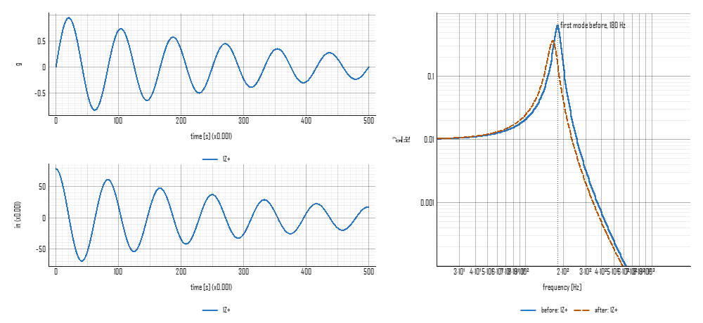

# Composing a figure from a script

Every reading in Visual Dynamics has a plot of its own, and selecting
several objects draws them together. A figure for a report or a page
sometimes needs more: two runs on one axis with the second dashed, a
mode marked and named on the curve, a record's time history beside its
spectrum, several panels held to one scale so they can be compared.
Five calls in `visualdynamics.plot` compose such a figure out of the
same drawing the application uses, so it carries the app's axes, units,
legends and theme, and is written to a file with no window.

## The five calls

- **`compose(build, path=..., theme=..., size=...)`** is the frame.
  `build(layout)` draws into a pyqtgraph layout; the figure is laid out
  off screen at `size` (logical pixels) and written to `path`, or shown
  in the application's data pane when `path` is omitted. It is the path
  every standalone plot in the package takes. `frequency_axis='log'`
  (or `'linear'`) holds for the figure and is put back afterwards.
- **`as_series(items)`** turns data arrays into the list the builders
  take. An item is a data array, `(name, data)`, or `(name, data,
  records)`; names prefix the legend entries when more than one object
  is named.
- **`figure_plots(layout, dimension=None)`** lists the plots in a
  figure, top to bottom and left to right, or only those drawing one
  quantity: `figure_plots(layout, 'length')` is the displacement plot of
  a stack, wherever it landed.
- **`to_view(plot, x=..., y=...)`** converts values in display units to
  the coordinates the plot's view holds. On a log axis the view works in
  decades, so a line, a label or a marker placed without the conversion
  lands at the logarithm of where it was meant to go. A curve added with
  `plot.plot` needs no conversion; pyqtgraph converts it.
- **`pin(plot, x=(low, high), y=(low, high))`** fixes the range a plot
  opens at, in display units. A plot drawn by `build_plots` limits zoom
  and pan to its own data, and a range set straight on the plot is
  clamped back inside that frame; `pin` makes the pinned range the
  plot's limit instead.

Panels side by side are nested layouts: `layout.addLayout(row=0,
col=1)` makes a panel, and `build_plots` draws into it as into a whole
figure, with its own stack and legends.

## An example



```python
import pyqtgraph as pg
from PySide6.QtCore import Qt

from visualdynamics.plot import (as_series, build_plots, compose,
                                 data_curves, figure_plots, pin, to_view)

def build(layout):
    left = layout.addLayout(row=0, col=0)
    right = layout.addLayout(row=0, col=1)
    build_plots(left, as_series([record]), theme='light')
    build_plots(right, as_series([('before', before), ('after', after)]),
                theme='light')

    asd = figure_plots(right, 'acceleration**2/frequency')[0]
    pin(asd, x=(20.0, 2000.0), y=(1e-4, 1.0))

    # the second run is told apart by its line, not only its color
    _, dashed = data_curves(asd)
    pen = pg.mkPen(dashed.opts['pen'])
    pen.setStyle(Qt.PenStyle.DashLine)
    dashed.setPen(pen)

    # a mark and a label, placed in hertz and g²/Hz
    x, y = to_view(asd, x=180.0, y=0.5)
    asd.addItem(pg.InfiniteLine(pos=x, angle=90,
                                pen=pg.mkPen('#555555',
                                             style=Qt.PenStyle.DotLine)))
    label = pg.TextItem('first mode before, 180 Hz', color='#222222',
                        anchor=(0, 1))
    label.setPos(x, y)
    asd.addItem(label)

compose(build, path='before-after.png', theme='light', size=(1000, 460),
        frequency_axis='log')
```

`record` holds an acceleration and a displacement, so `build_plots`
stacks them on two plots in the left panel. `before` and `after` are
ASDs of one channel, drawn on the one plot in the right panel.

## The theme

`theme` on `compose` sets the frame: the ground under the plots and
the default colors of anything drawn by hand with pyqtgraph. The
builders are told the theme themselves, as `build_plots(...,
theme='light')` above, which is how the application calls them too.
Give both the same theme. A builder told nothing draws in the default
theme, light.

## What is refused

Each call refuses what cannot be drawn and says why, before anything is
drawn where it can:

- `compose`: a `build` that is not a function; a size that is not two
  positive numbers; a file extension that names no image type (`.svg`,
  `.png`, `.jpg` and the other types Qt writes are accepted, `.pdf` is
  not); a `frequency_axis` that is not a setting, or one given without
  `path`, since a shown pane may redraw after the setting is put back.
- `as_series`: nothing to draw; an item that is not a data array, or a
  tuple that is not two or three long; a name that is not a string;
  records that are empty, are not indices, or are not in the array
  (a negative index included, which would otherwise count from the
  end).
- `figure_plots`: a dimension the units do not track (`'displacment'`),
  and a quantity no plot in the figure draws; the message lists the
  quantities it does draw.
- `to_view` and `pin`: a value that is not finite, a zero or negative
  value on a log axis, and a range whose low end is not below its high
  end.

`plot_series` reads its items through `as_series`, so it refuses the
same items.

## Writing for print

A composed figure is written the way every standalone plot is: a
`.png` at one pixel per logical pixel, or at `visualdynamics.plot.
EXPORT_DPI` when that is set. Lay the figure out at its printed size
(inches times 96) and set the resolution, as
[Figures for print](plotting.md#figures-for-print) describes.
